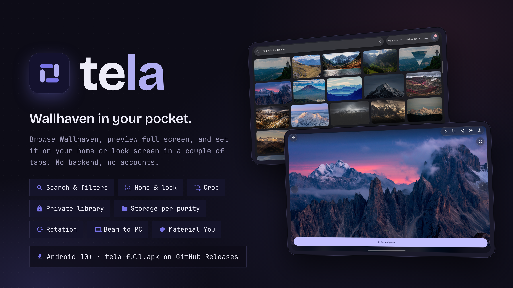

#  tela



**Wallhaven in your pocket.** tela is an Android app for browsing
[Wallhaven](https://wallhaven.cc), previewing a wallpaper full screen and
setting it as your home or lock screen in a couple of taps. It has no backend,
no accounts and no tracking; it talks to Wallhaven and nothing else.

[Install](#install) · [Editions](#editions) · [Features](#features) ·
[Building](#building-from-source) · [Release notes](docs/releases) ·
[Releasing](docs/RELEASING.md)

- **Browse and search:** Latest, Toplist, Hot and Random, with categories,
  purity, sorting, colors and include/exclude tags.
- **Preview, then set:** a full-screen, pinch-to-zoom preview; crop, then set
  it on the home screen, the lock screen or both.
- **Downloads that go where you say:** the Gallery, a folder outside the
  Gallery, or a private library only tela can see, chosen separately for safe
  and explicit wallpapers.
- **Private library:** screenshot-proof, hidden from the app switcher, with an
  optional fingerprint, face or PIN lock.
- **Rotation:** change the wallpaper every 15 minutes, hour, 6 hours or day
  from your downloads.
- **Beam to a computer:** send wallpapers to a desktop on your network over
  [LocalSend](https://localsend.org).

## Install

**[Download the latest APK](https://github.com/mateuspim/tela/releases/latest/download/tela-full.apk)**
· [All editions and release notes](https://github.com/mateuspim/tela/releases/latest)

Requires **Android 10 or newer** (API 29). Phones and tablets are both
supported; the layout adapts to wide screens.

1. Download `tela-full.apk` on your Android device and open it.
2. If prompted, allow your browser or file manager to install unknown apps,
   then confirm **Install**.
3. To update, download the latest APK from the same link and install it over
   the existing app. **Do not uninstall to update**: uninstalling deletes the
   private library, the database and the stored API key.

Each release includes `SHA256SUMS`, and every APK is signed with the same
release key. Verification steps and the certificate fingerprint are in
[the release guide](docs/RELEASING.md#downloads-and-verification).

### The API key

Safe browsing works with no key. A [Wallhaven API
key](https://wallhaven.cc/settings/account) (Settings › API key) unlocks
explicit content, your account's browsing defaults and your collections. It is
stored encrypted in the Android Keystore, sent only in the `X-API-Key` header,
and never logged.

## Editions

Every release builds four editions from the same commit. They install side by
side and do not share data.

| Edition | APK | Sources | API key and explicit content |
|---|---|---|---|
| **Full** | `tela-full.apk` | Wallhaven + Konachan | yes |
| Wallhaven | `tela-wallhaven-vX.Y.Z.apk` | Wallhaven | yes |
| Safe | `tela-safe-vX.Y.Z.apk` | Wallhaven + `konachan.net` | no |
| Play | `tela-play-vX.Y.Z.apk` | Wallhaven | no |

Pick **Full** unless you want a build that cannot show explicit content at all;
Safe and Play leave that code out at compile time.

## Features

- **Browse:** an adaptive grid that loads as you scroll. Switch the source
  and sort from the search bar; the filter sheet holds categories, purity,
  toplist range, resolution, ratio, color and tags (must include / must
  exclude). Tap a tag on any wallpaper to see everything with that tag.
- **Detail:** full-resolution preview with pinch zoom and swipe to the next
  wallpaper. Pull up for resolution, size, category, purity, views,
  favorites, tags and colors. Actions: favorite, crop, share, beam, download.
- **Set wallpaper:** home, lock or both, applied through Android's own
  wallpaper service, with an optional crop first.
- **Library:** favorites, download history (tap one to set it again), the
  download queue, your tags and your Wallhaven collections.
- **Storage, per purity:** safe wallpapers default to the Gallery
  (`Pictures/tela`) and explicit ones to the private library. Either can be
  sent to a `.nomedia` folder on shared storage instead, reachable over USB or
  a file manager but kept out of Photos, or to an SD card. Explicit files are
  **never** indexed by the Gallery, in any destination.
- **Tags as folders:** a download can carry a tag, and each tag becomes a
  folder in every destination. *Download all* on a tag files everything at once.
- **Rotation:** a schedule that picks the next wallpaper from the Gallery,
  the files folder or the private library, onto home, lock or both.
- **Beam:** finds LocalSend receivers on your network, or takes an address,
  and sends one wallpaper or a selection.
- **Material You:** follows your system colors, and the detail screen tints
  its controls from the wallpaper you are looking at.

## Building from source

There is **no Flutter or Android SDK on the host**. Everything runs in a pinned
container (Flutter 3.44.6, Android SDK 36, minSdk 29), so a green build here is
a green build anywhere. You need Docker or Podman.

```bash
./tool/tela analyze            # must be clean before every commit
./tool/tela test               # the Dart suite
make kotlin-test               # the native suite (Robolectric, no device)
make ci                        # analyze + both suites, as the merge gate runs them
./tool/tela build apk --debug
./tool/tela --shell            # poke around inside the container
```

The image is built the first time you run any of these. Pub and Gradle caches
live in named volumes, so only the first build is slow. Run `make hooks` once
per clone to install the merge gate.

A release build needs the release key (`android/key.properties`); without it
the build fails rather than falling back to debug signing. Set
`TELA_ALLOW_DEBUG_SIGNING=1` for a local build you will not install over a
release. Editions, signing and tagging are in
[`docs/RELEASING.md`](docs/RELEASING.md).

### Running on a device

The container shares the host network and USB bus, so `adb` inside it sees
what the host sees. Enable USB or wireless debugging, then `make deploy`
(`make deploy EDITION=safe` for another edition).

### Contributing

The coding contract is [`CLAUDE.md`](CLAUDE.md): Clean layering with a pure-Dart
domain, every plugin behind a project-owned interface, no hardcoded strings.
Scope and architecture rationale are in [`PLAN.md`](PLAN.md), and the visual
identity in [`docs/BRAND.md`](docs/BRAND.md).

## License

[MIT](LICENSE). Wallpapers belong to their authors; tela only shows what
Wallhaven and Konachan serve.
